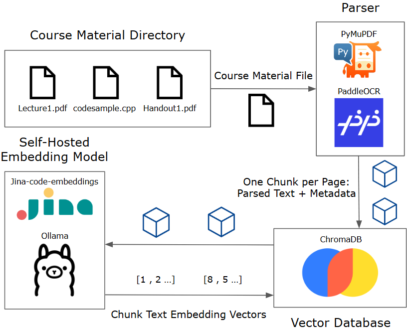
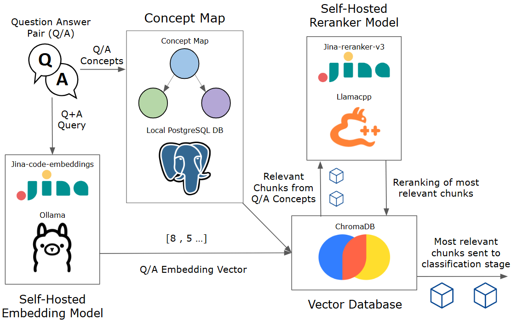

# Conc3ept
### A self-hosted distributed RAG classification system for constructive alignment of assessments.

Conc3ept is a tool for instructors to improve the constructive alignment of their assessments with their course materials.
#### Inputs
- A JSON of your course's questions
- Course materials such as lectures and code examples
  
#### Outputs
- LLM-identified concepts, mapped back to an instructor-defined map of course concepts
- For each concept:
  - A Revised Bloom's Taxonomy cognitive level
  - A cited explanation for the classification, referencing relevant course materials

These outputs help instructors check what their assessments are testing: are students simply recalling facts from lecture, or using creative problem solving to tackle unseen problems?


| Course Material Parsing and Embedding | Context Retrieval and Reranking |
| :---: | :---: |
|  |  |


This project was created for the constructive alignment of UCSB's CS16 course, so a lot of the code is written to interface with other teaching team backend scripts.

It has only been tested on Ubuntu 22.04.

**This project is still under development, mainly focusing on user experience as most functionality is implemented.**

RAG Stack:
- Ollama (local classification LLM hosting)
- llama.cpp (self-hosted re-ranker server for custom jina architecture)
- ChromaDB (vector database for parsed course materials)
- safetensors (C++ API for copy-free tensor manipulation)
  
Parsing stack:
- PyMuPDF (PDF text layer extraction)
- PaddleOCR (OCR when images are detected)
  
Network / IPC Stack:
- Boost.ASIO (network library, using TLS functionality for distributed processing)
- Unix Domain Sockets (for single-machine hosting)
  
UI Stack:
- React (frontend)
- Flask (backend)
- PostgreSQL (metadata storage)

*conc3ept UI lives in a separate repository

## Install
To start, run `pip install -r requirements.txt` in a conda or venv.

You'll also need to install [Ollama](https://docs.ollama.com/linux) and [PostgreSQL](https://www.postgresql.org/download/linux/ubuntu/) if you haven't already.

You may need to redirect Ollama's environment variables to point to a model folder of your choosing.

For the reranker server, it is specifically implemented for jina-reranker-v3, and looks for a .gguf file (can be found [here](https://huggingface.co/jinaai/jina-reranker-v3-GGUF)).
- Note: it is of interest to support different reranking models
  
For ChromaDB and classification, you can pull any model using Ollama (make sure its pointed to the correct directory).
You may also want to create custom model files to finetune performance and restrict some models to CPU or GPU.
The tested implementation puts jina-code-embeddings-1.5b on CPU, and a Qwen3.5 9B on GPU.

### CMake Build
cd into `src/reranker` and run:
```
mkdir build
cd build
cmake -S .. -B.
cmake --build . -j
```
This will build llama.cpp automatically and include the header-only Boost.asio and safetensors libraries.

## Usage
### Question Input
For inputting questions, you should have a JSON containing a single list, each object representing a question and containing at least the following keys:
```
content - string
id - int
tags - list[string]
```
**content** is a string containing a question and answer written in LaTex. It should have AnswerArea, item, and Solution environments/commands for info to be parsed correctly.

**id** is a unique integer identifier for each question.

**tags** is a list of concepts. These are used to focus the RAG retrieval on only course materials tagged with those concepts, providing the classification more relevant context.

Run `py latexparse.py <input_json_path> <output_json_path>` to get a JSON containing parsed question/answer info ready to feed into Conc3ept.

### Course Material Parsing

Currently a path must be written in the code to a directory containing your course materials. All materials should be at the top level of this dedicated directory.

The default implementation supports `.cpp`, `.py`, and `.cc` files, but this can be easily extended by adding onto the conditional's list in line 77 of `parsing.py`:
`elif os.path.splitext(file)[1] in [".cpp", ".py", ".cc", ".h", ".html", ".java", ...]`

PyMuPDF will be used to parse any PDFs, and if any images are detected, PaddleOCR is used parse text. Code files are treated as plaintext and stored as they are.

Parsing yields parsed text via the generator `walkParse`, allowing memory efficient and checkpointed parsing. Yielded text is added to a persistent ChromaDB collection.

Parsed files are marked "parsed" in the PostgreSQL database, and document ids persist across parse runs so the generator picks up where it left off if it was interrupted.


